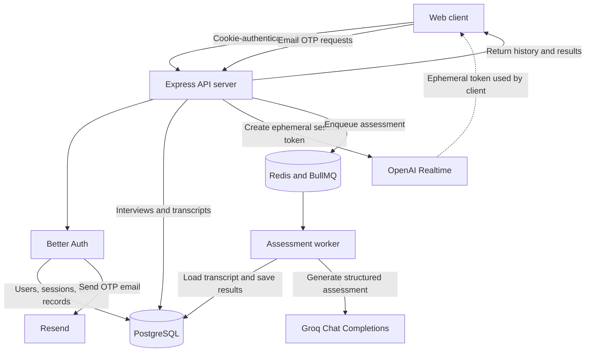
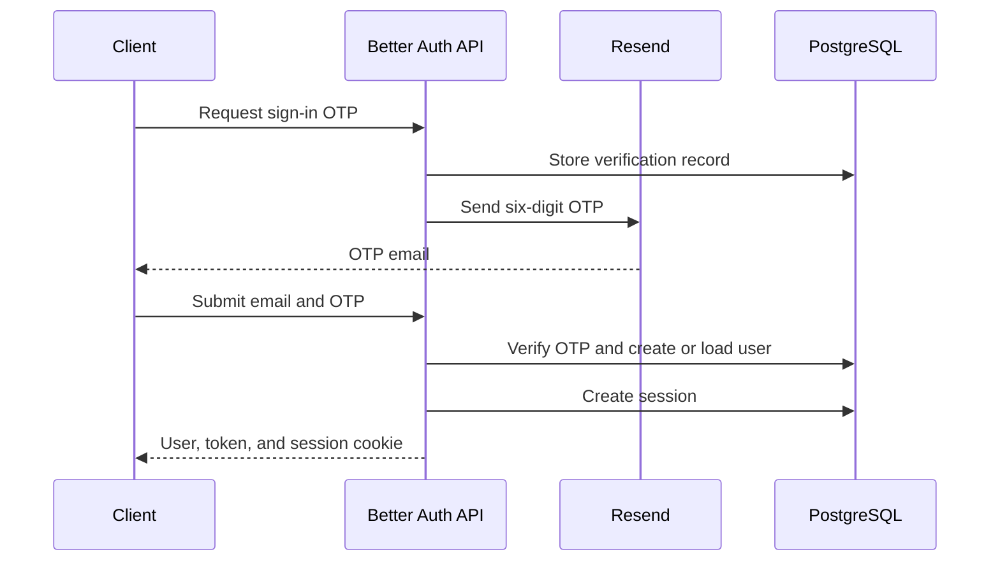
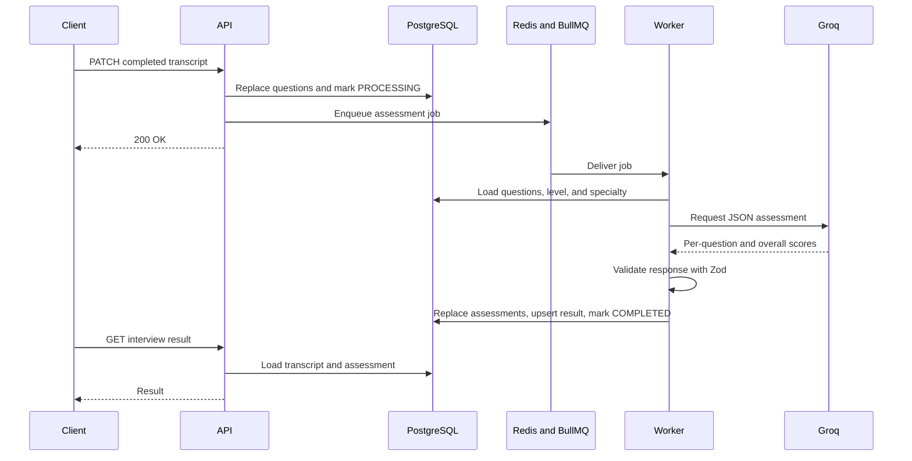
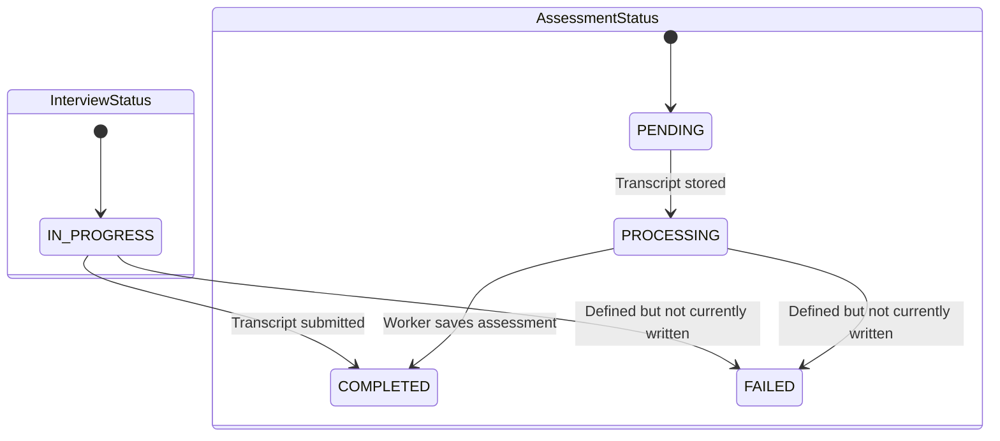
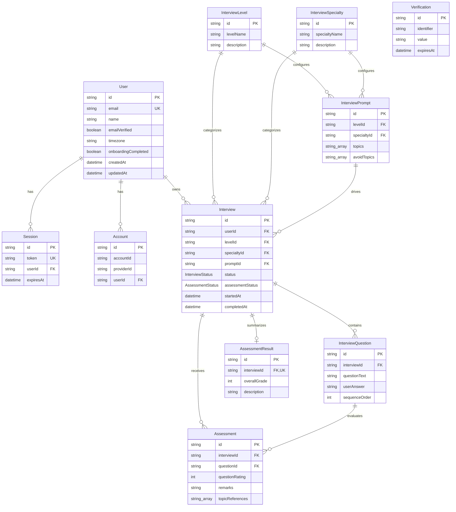

# Candor Backend

Candor is the backend for an AI-powered mock interview application. It authenticates users with email OTPs, creates realtime interview sessions, stores interview transcripts, and asynchronously generates structured feedback and scores.

## Table of contents

- [System architecture](#system-architecture)
- [Core workflows](#core-workflows)
- [Tech stack](#tech-stack)
- [Project structure](#project-structure)
- [Database schema](#database-schema)
- [API](#api)
- [Authentication](#authentication)
- [Background assessment worker](#background-assessment-worker)
- [Configuration](#configuration)
- [Local development](#local-development)
- [Security, limits, and observability](#security-limits-and-observability)
- [Current operational notes](#current-operational-notes)

## System architecture

Candor runs as two Node.js processes:

1. **API server** — serves Better Auth and versioned application endpoints.
2. **Assessment worker** — consumes BullMQ jobs and evaluates completed interviews.

PostgreSQL is the source of truth. Redis transports assessment jobs between the API and worker. OpenAI provides short-lived Realtime credentials for the interview client, Groq evaluates completed transcripts, and Resend delivers authentication OTPs.



### Application layers

Versioned API requests follow a conventional layered architecture:

```text
route -> authentication/validation middleware -> controller -> service -> repository -> Prisma -> PostgreSQL
```

- **Routes** define paths and middleware.
- **Controllers** translate HTTP requests and responses.
- **Services** enforce ownership, quotas, lifecycle rules, and external API orchestration.
- **Repositories** isolate Prisma queries and database transactions.
- **Containers** construct and connect repositories, services, and controllers.
- **Jobs** hold BullMQ queue and worker processing logic.

The API middleware order is:

```text
Helmet -> CORS -> Pino HTTP logging -> general rate limit
       -> Better Auth routes -> JSON parser -> /api/v1 routes -> error handler
```

## Core workflows

### Sign-in flow

Candor uses passwordless email OTP authentication.



OTPs are six digits, expire after five minutes, and allow three verification attempts. New users may be created through the sign-in OTP flow. Password authentication and social providers are not configured.

### Interview creation flow

1. Authenticate the user from the Better Auth session cookie.
2. Reject the request if the user already has an `IN_PROGRESS` interview.
3. Count interviews created during the current day in the user's configured timezone.
4. Enforce `INTERVIEW_CREATE_LIMIT`.
5. Load the prompt configured for the requested level and specialty.
6. Create an interview with `IN_PROGRESS` / `PENDING` states.
7. Build system instructions from the prompt's included and excluded topics.
8. Request an ephemeral OpenAI Realtime token using `gpt-realtime-2` and the `marin` voice.
9. Return the interview ID and ephemeral token to the client.

If OpenAI token creation fails, the newly created interview is deleted.

The backend does not proxy the live audio session. The client uses the ephemeral token to connect to OpenAI Realtime, then submits the final transcript to the API.

### Completion and assessment flow



Transcript persistence is transactional: existing questions are replaced and the interview is marked complete in one database transaction. Assessment persistence is also transactional: per-question assessments are replaced, the overall result is upserted, and the assessment status is marked complete together.

### Lifecycle states



## Tech stack

| Area | Technology | Role |
| --- | --- | --- |
| Runtime | Node.js, TypeScript, native ESM | Strictly typed backend runtime |
| HTTP | Express 5 | API server and routing |
| Authentication | Better Auth, email OTP plugin | Users, sessions, OTP sign-in |
| Validation | Zod | Request and AI-response validation |
| Database | PostgreSQL 16 | Persistent application and auth data |
| ORM | Prisma 7 with `@prisma/adapter-pg` | Schema, migrations, queries, transactions |
| Queue | BullMQ | Reliable asynchronous assessment jobs |
| Queue transport | Redis 7 via ioredis | Job persistence and worker coordination |
| Realtime AI | OpenAI Realtime API | Live mock interview sessions |
| Assessment AI | Groq, `llama-3.3-70b-versatile` | Transcript grading and feedback |
| Email | Resend | OTP delivery |
| Security | Helmet, CORS | Security headers and browser-origin policy |
| Rate limiting | express-rate-limit | General and authentication request limits |
| Logging | Pino, pino-http | Structured application and request logs |
| Timezones | date-fns-tz | Per-user daily interview quota windows |
| Development | tsx | TypeScript watch mode for API and worker |

TypeScript targets ES2023 with `NodeNext` module resolution. The project does not currently pin a Node.js version; use a current Node.js release with native `fetch` support.

## Project structure

```text
.
├── prisma/
│   ├── migrations/              # PostgreSQL schema history
│   ├── schema.prisma            # Data model and generated-client config
│   └── seed.ts                  # Initial levels, specialties, and prompts
├── src/
│   ├── configs/                 # Auth, DB, Redis, logging, rate limits, prompts
│   ├── containers/              # Dependency composition roots
│   ├── controllers/             # HTTP response handling
│   ├── generated/prisma/        # Generated Prisma client; gitignored
│   ├── jobs/                    # Assessment queue and processor
│   ├── middleware/              # Authentication, validation, error handling
│   ├── repositories/            # Prisma persistence layer
│   ├── routes/v1/               # Versioned application routes
│   ├── services/                # Domain rules and external API orchestration
│   ├── types/                   # Express and domain TypeScript types
│   ├── utils/                   # Zod schemas, prompts, templates, errors
│   ├── server.ts                # API process entry point
│   └── worker.ts                # BullMQ worker entry point
├── docker-compose.yml           # Intended API, worker, PostgreSQL, Redis topology
├── prisma.config.ts             # Prisma migrations and seed configuration
├── package.json
└── tsconfig.json
```

## Database schema

The Prisma schema contains Better Auth tables and the interview domain model.



### Model responsibilities

| Model | Responsibility |
| --- | --- |
| `User` | Identity, profile, timezone, and onboarding state |
| `Session` | Better Auth session token, expiry, and client metadata |
| `Account` | Better Auth provider or credential account data |
| `Verification` | OTP and verification state |
| `InterviewLevel` | Interview difficulty metadata |
| `InterviewSpecialty` | Interview subject metadata |
| `InterviewPrompt` | Allowed and avoided topics for a level/specialty pair |
| `Interview` | Central interview aggregate and lifecycle state |
| `InterviewQuestion` | Ordered transcript question/answer pair |
| `Assessment` | Per-question rating, remarks, and topic references |
| `AssessmentResult` | One overall score and description per interview |

### Constraints and referential behavior

- `User.email`, `Session.token`, and `AssessmentResult.interviewId` are unique.
- `AssessmentResult.interviewId` enforces one overall result per interview.
- Deleting a user cascades to Better Auth sessions and accounts.
- Interview-domain foreign keys use restrictive deletion behavior; referenced records must be removed in dependency order.
- Prompt selection uses the first matching level/specialty record. The pair is not currently unique at the database level.
- `Assessment` references both an interview and a question; application logic must ensure that the question belongs to the same interview.
- Frequently queried interview-domain foreign keys do not currently have explicit Prisma indexes.

### Seed data

`prisma/seed.ts` creates:

- Levels: **Junior**, **Senior**
- Specialties: **React**, **Frontend**, **Backend**, **Data Structures and Algorithms**, **Javascript**, **System Design**
- Prompt configurations for **Junior + Frontend** and **Junior + Backend**

The seed uses plain creates rather than upserts and is therefore not idempotent. Run it once against a clean development database unless duplicate seed records are acceptable.

## API

The default local base URL is `http://localhost:3000`.

- Better Auth routes are mounted at `/api/auth/*`.
- Application routes are mounted at `/api/v1`.
- Every `/api/v1` route requires a valid Better Auth session cookie.
- Cross-origin browser requests must include credentials.
- Custom application routes do not currently use query parameters or pagination.

### Application endpoints

| Method | Path | Input | Success response | Purpose |
| --- | --- | --- | --- | --- |
| `PATCH` | `/api/v1/users/complete-profile` | `{ name, timezone }` | `200` user object | Save profile data and mark onboarding complete |
| `GET` | `/api/v1/interviews/levels` | None | `200 { data: [...] }` | List available levels |
| `GET` | `/api/v1/interviews/specialties` | None | `200 { data: [...] }` | List available specialties |
| `POST` | `/api/v1/interviews` | `{ levelId, specialtyId }` | `201 { interviewId, ephemeralToken }` | Create an interview and OpenAI Realtime credential |
| `GET` | `/api/v1/interviews` | None | `200 [...]` | List the current user's interviews, newest first |
| `GET` | `/api/v1/interviews/:id` | Interview ID | `200` interview object | Get one owned interview |
| `PATCH` | `/api/v1/interviews/:id` | `{ transcript: [...] }` | `200`, currently no body | Complete an interview and queue assessment |
| `GET` | `/api/v1/interviews/:id/result` | Interview ID | `200` transcript and result | Get questions, per-question assessments, and overall result |

`POST /api/v1/interviews` accepts UUIDs:

```json
{
  "levelId": "f52092f3-8198-4368-b6a7-f24cbbaf8f99",
  "specialtyId": "45c8fce1-9df8-421c-bb93-23a1290797aa"
}
```

A completed transcript has this shape:

```json
{
  "transcript": [
    {
      "questionText": "What is dependency injection?",
      "userAnswer": "Dependency injection provides dependencies from outside...",
      "sequenceOrder": 1
    }
  ]
}
```

The result endpoint returns data in this shape while assessment fields may remain empty until the worker finishes:

```json
{
  "id": "interview-id",
  "userId": "user-id",
  "questions": [
    {
      "id": "question-id",
      "questionText": "What is dependency injection?",
      "userAnswer": "Dependency injection provides dependencies from outside..."
    }
  ],
  "assessment": [
    {
      "questionRating": 8,
      "remarks": "Clear explanation with a useful example.",
      "topicReferences": ["dependency inversion", "testability"]
    }
  ],
  "result": {
    "overallGrade": 8,
    "description": "Strong foundational backend knowledge."
  }
}
```

### Error responses

Application errors use a common JSON envelope:

```json
{
  "code": "VALIDATION_ERROR",
  "message": "Error details"
}
```

| Status | Code | Typical cause |
| --- | --- | --- |
| `400` | `VALIDATION_ERROR` | Invalid body or route parameters |
| `401` | `AUTHENTICATION_ERROR` | Missing or invalid session |
| `403` | `UNAUTHORIZED_ERROR` | Interview belongs to another user |
| `404` | `NOT_FOUND_ERROR` | Interview, level, specialty, or prompt not found |
| `409` | `CONFLICT_ERROR` | User already has an active interview |
| `429` | `RATE_LIMIT_ERROR` | Request limit or daily interview quota exceeded |
| `500` | `JOB_ERROR` | Assessment job could not be queued |
| `500` | `EXTERNAL_API_ERROR` | OpenAI or Groq request failed |
| `500` | `InternalServerError` | Unexpected unhandled failure |

## Authentication

The intended client authentication flow uses these Better Auth endpoints:

| Method | Path | Purpose |
| --- | --- | --- |
| `POST` | `/api/auth/email-otp/send-verification-otp` | Send a sign-in OTP |
| `POST` | `/api/auth/sign-in/email-otp` | Verify the OTP and create a session |
| `GET` | `/api/auth/get-session` | Read the current session |
| `POST` | `/api/auth/sign-out` | Revoke the current session |

Request a sign-in OTP:

```json
{
  "email": "developer@example.com",
  "type": "sign-in"
}
```

Verify it:

```json
{
  "email": "developer@example.com",
  "otp": "123456",
  "name": "Ada Lovelace",
  "timezone": "Europe/London"
}
```

Only `email` and `otp` are required for existing users. Better Auth owns the exact auth response and cookie format. Because its complete handler is mounted at `/api/auth/*`, additional library-provided session/account routes may also be exposed; consult the Better Auth version pinned in `package.json` before relying on them.

Browser clients must send the session cookie:

```ts
await fetch("http://localhost:3000/api/v1/interviews", {
  credentials: "include",
});
```

## Background assessment worker

The worker listens to the `assessments` queue with a concurrency of **5**.

Each queued job:

1. Loads the interview questions, level, and specialty.
2. Formats the transcript.
3. Builds an assessment prompt.
4. Calls Groq's OpenAI-compatible chat completions endpoint.
5. Requires JSON with per-question scores and an overall score.
6. Validates all ratings as integers from 1 through 10.
7. Saves assessments and marks the interview assessment `COMPLETED`.

Jobs are configured with three attempts and exponential backoff beginning at two seconds. Worker completion and failure events are logged with Pino.

## Configuration

Copy the tracked template before starting development:

```bash
cp .env.example .env
```

The source code uses the following variables:

| Variable | Required by | Description |
| --- | --- | --- |
| `DATABASE_URL` | API, worker, Prisma | PostgreSQL connection URL |
| `REDIS_URL` | API, worker | Redis connection URL used by BullMQ |
| `BETTER_AUTH_SECRET` | API | Better Auth signing/encryption secret |
| `CORS_ORIGIN` | API | Deployed frontend origin and trusted auth origin |
| `RESEND_API_KEY` | API | Resend API key |
| `RESEND_FROM_EMAIL` | API | Verified sender used for OTP email |
| `OPENAI_API_KEY` | Interview creation | OpenAI Realtime credential creation |
| `GROQ_API_KEY` | Worker | Transcript assessment generation |
| `INTERVIEW_CREATE_LIMIT` | Interview creation | Maximum interviews per user-local calendar day |
| `PORT` | API | Optional HTTP port; defaults to `3000` |
| `NODE_ENV` | API, worker | Controls production logging, auth rate limits, and Prisma reuse |

Never commit `.env` or `.env.docker`; both are ignored by Git.

### CORS and trusted origins

Express permits credentialed requests from:

- `http://localhost:5173`
- `CORS_ORIGIN`

Better Auth additionally trusts `http://localhost:3000`, `http://localhost:5173`, and `http://localhost:5174`. Keep the Express CORS and Better Auth origin lists aligned when adding clients.

## Local development

### Prerequisites

- A current Node.js and npm installation
- PostgreSQL
- Redis
- Resend, OpenAI, and Groq credentials

### Install and prepare the database

```bash
npm install
cp .env.example .env
npx prisma generate
npx prisma migrate dev
npx prisma db seed
```

`npx prisma generate` is required because the generated client lives in `src/generated/prisma` and is not committed.

Seeding is optional if levels, specialties, and prompts are managed another way. Remember that the current seed is not idempotent.

### Run the processes

Run the API and worker in separate terminals:

```bash
npm run dev
```

```bash
npm run worker
```

Available package scripts:

| Command | Behavior |
| --- | --- |
| `npm run dev` | Run `src/server.ts` in watch mode |
| `npm run worker` | Run `src/worker.ts` in watch mode |
| `npm test` | Placeholder that exits with an error; no test suite is configured |

## Security, limits, and observability

- Helmet sets standard HTTP security headers.
- CORS is credential-aware and restricted to configured frontend origins.
- Protected routes resolve the Better Auth session and attach its user to the request.
- Interview services enforce resource ownership before returning or changing data.
- Zod validates profile, interview creation, transcript completion, and AI assessment payloads.
- The OpenAI request includes the user ID as `OpenAI-Safety-Identifier`.
- General traffic is limited to **100 requests per IP per 15 minutes**.
- Auth traffic has an additional limit of **20 per 15 minutes in production** and **200 outside production**.
- Rate limiters currently use in-memory storage, so limits are per API process rather than global across replicas.
- `app.set("trust proxy", 1)` assumes one trusted reverse proxy hop.
- Development logs use pretty `debug` output; production uses structured `info` output.
- Unexpected errors are logged and returned to clients as a generic 500 response.

## Current operational notes

The architecture is implemented, but the repository is not yet production-complete:

- `docker-compose.yml` describes PostgreSQL, Redis, API, and worker services, but no `Dockerfile` is currently present.
- Compose expects `.env.docker`, and its PostgreSQL health check still contains a `<project>` username placeholder.
- `package.json` does not provide production `build` or `start` scripts, while Compose expects compiled `dist/worker.js` output.
- There is no automated test suite, health/readiness endpoint, or graceful shutdown handling.
- Transcript persistence and queue insertion are separate operations. If enqueueing fails, the interview can remain in `PROCESSING` without a job.
- Failed or exhausted assessment jobs are logged but do not currently set `assessmentStatus` to `FAILED`.
- External OpenAI and Groq requests do not currently define application-level timeouts.
- Queue jobs do not define an explicit retention/removal policy.
- In-memory rate limiting is unsuitable for globally coordinated limits across multiple API replicas.
- `GET /api/v1/interviews/:id` and `/result` do not currently apply UUID parameter validation, unlike the completion endpoint.

These are important follow-up areas before relying on the supplied Compose topology or horizontally scaling the service.
